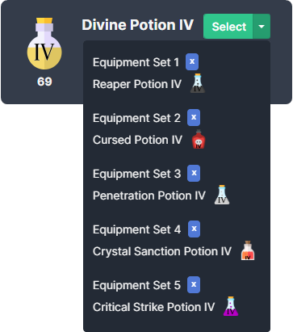
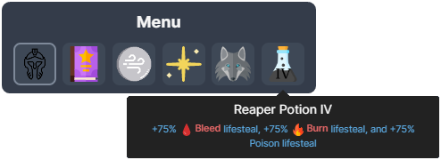
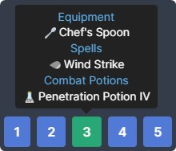
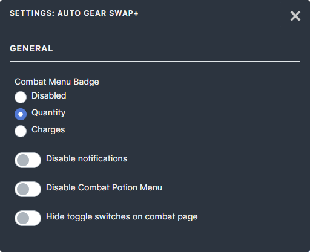

# Auto Gear Swap+

A Melvor Idle Mod on [Mod.io](https://mod.io/g/melvoridle/m/agsplus)

This mod will change your active gear set based on the [Combat Triangle](https://wiki.melvoridle.com/w/Combat_Triangle) and uses combat potions assigned to a set automatically. Includes a few options to toggle features.

## Features

### Automatically swap gear sets to counter enemy combat style

- Picks the set that does best against each enemy using the game's own combat triangle for the area and game mode, so reversed areas (Into the Abyss) and Hardcore triangles are handled
- Prefers higher damage, then higher damage reduction, then the lowest set number; stays in the current set when no other set is better
- Skips swaps the game would refuse (dungeons and strongholds without swapping, damage types the area or enemy doesn't allow)

### Set roles

Each equipment set has a role, set under the Auto Swap / Auto Potion switches for the selected set: **Auto** (from its weapon), **Melee**, **Ranged**, **Magic**, or **Never** (never swapped to, e.g. a skilling set).

### Assign potions to gear sets from potion select menu

Choosing a set that already has that potion, or its **x**, removes it again.

### Potion button in combat player menu

### Equipment set tooltips show assigned potions

### Options

